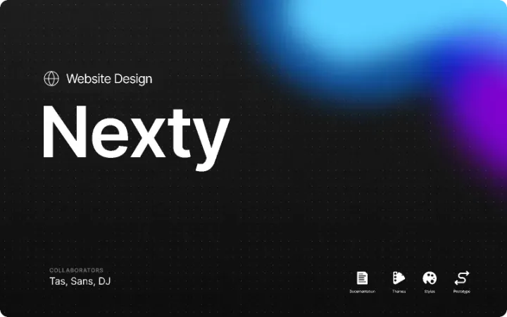

# Nexty Website — Mobile-First MVP

A high-performance, mobile-first website for **Nexty**, built with **Next.js 15 (App Router)**, **TypeScript**, and **Tailwind CSS**, meticulously crafted according to the official Figma design specifications and style guide.



---

## 🌟 Key Scope & Interactions

This project delivers the exact 3 core conversion interactions required:

1. **Call Me Now** (`/components/CallMeModal.tsx` & `/app/api/call-me-now/route.ts`):
   - Bottom sheet / accessible modal that captures the visitor's phone number with real-time validation.
   - Automatically hits the serverless API route `/api/call-me-now`.
   - Supports instant outbound webhook notifications (Discord, Slack, Telegram bot, Zapier, or Make) so your team can call leads back within minutes.
2. **Book a Call** (`/components/CalendlyModal.tsx`):
   - Clean pop-up modal with responsive Calendly embedding.
   - Configurable scheduling link through environment variable `NEXT_PUBLIC_CALENDLY_URL`.
3. **Talk on WhatsApp** (`/components/Hero.tsx` & `/components/ClosingCTA.tsx`):
   - Direct WhatsApp Business conversation deep-link (`https://wa.me/...`) with a personalized pre-filled message.
   - Configurable phone number via `NEXT_PUBLIC_WHATSAPP_NUMBER`.

---

## 🎨 Design System Implementation

Extracted directly from the Figma style guide and assets:

- **Mobile Spacing**:
  - Max Width: `393px` (standard iPhone viewport)
  - Side Margins: `22px`
  - Content Width: `350px`
  - Section Spacing: `48px` – `56px`
- **Border Radii**:
  - Buttons & Small Tiles: `14px` (`rounded-btn`)
  - Cards: `20px` (`rounded-card`)
  - Large Cards / Photos: `24px` (`rounded-card-lg`)
  - Pills / Chips: `9999px` (`rounded-full`)
- **Color Palette**:
  - **Burnt Orange**: `#BD5216` (Primary CTA, highlights)
  - **Deep Brown**: `#593213` (Headings, primary dark text)
  - **Cream**: `#FFF5EC` (Page background)
  - **Sage**: `#828866` ("Call Me Now" button, badges)
  - **Warm White**: `#FFFBFA` (Cards, surfaces)
  - **Sand**: `#E8D3BE` / **Sand Border**: `#E3CDB5`
- **Typography**:
  - Headings & Quotes: **Rufina** (Google Fonts, weights 400 & 700)
  - Wordmark Logo: **Gabriela** (Google Fonts)
  - Body & Buttons: **Inter** / **SF Pro**

---

## 🚀 Getting Started

### Prerequisites
- Node.js 18+ (tested on Node v24)
- npm 10+

### Installation
```bash
# Install dependencies
npm install

# Start local development server
npm run dev
```

Open [http://localhost:3000](http://localhost:3000) in your browser. We recommend opening DevTools (`F12`) and switching to responsive mobile view (iPhone 14 / 393px width) to experience the mobile-first design.

### Production Build
```bash
npm run build
npm start
```

---

## ⚙️ Environment Variables

Copy `.env.example` to `.env.local` to customize links and notification settings:

```bash
cp .env.example .env.local
```

| Variable | Description | Default / Example |
| :--- | :--- | :--- |
| `NEXT_PUBLIC_WHATSAPP_NUMBER` | Your WhatsApp Business phone number with country code | `15551234567` |
| `NEXT_PUBLIC_CALENDLY_URL` | Your Calendly scheduling URL | `https://calendly.com` |
| `NEXTY_NOTIFICATION_WEBHOOK` | Optional webhook URL (Discord / Slack / Telegram) for "Call Me Now" alerts | *Optional* |

---

## 📂 Project Structure

```text
├── app/
│   ├── api/
│   │   └── call-me-now/
│   │       └── route.ts         # Serverless API endpoint for phone callback leads
│   ├── globals.css              # Tailwind base, typography & custom scrollbar
│   ├── layout.tsx               # Root layout with Rufina, Gabriela & Inter fonts
│   └── page.tsx                 # Main mobile-first landing page & modal controllers
├── components/
│   ├── Navbar.tsx               # Header with fox mark logo and CTA button
│   ├── Hero.tsx                 # Hero section with interactive chat & 3 CTAs
│   ├── HowItWorks.tsx           # 3-step value proposition & community photo card
│   ├── ClosingCTA.tsx           # Secondary conversion section
│   ├── CallMeModal.tsx          # "Call Me Now" phone capture modal with instant feedback
│   ├── CalendlyModal.tsx        # "Book a Call" Calendly integration modal
│   └── Footer.tsx               # Sleek footer with navigation & copyright
├── public/
│   └── assets/                  # High-resolution logos, gradients & community images
├── tailwind.config.ts           # Custom Tailwind theme matching Figma color tokens
└── README.md                    # Project documentation
```

---

## 🚢 Deployment

This project is optimized for zero-configuration deployment on **Vercel**:

1. Push this repository to GitHub, GitLab, or Bitbucket.
2. Import the repository into [Vercel](https://vercel.com).
3. Add your environment variables in the Vercel dashboard.
4. Deploy! Your site will be live on a global Edge network with automatic HTTPS.
